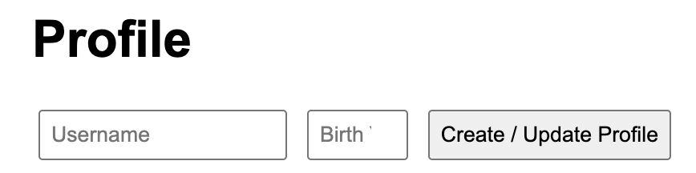
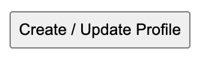
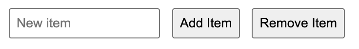

# Assignment 5

Name: Azamat Merzemkhan  
Group: IT-2513

## Part 1: Profile and calculations

Task 1: Created userProfile with a name, birth year, developer status and hobbies.

Task 2: Calculated age using the current year. Displayed age, approximate months and hobby count on the page and in the console.

## Part 2: Profile form

Task 3: Added username and birth year inputs with a submit button.

Task 4: Used a submit event listener to update the object and display the new profile.

## Part 3: Hobbies list

Task 5: Add Item creates a new list item. Remove Item deletes the last one. Both buttons update the hobbies array and count.

## Summary

I made the HTML form and list, added basic CSS, then used JavaScript to display the profile and handle the buttons.# web5
